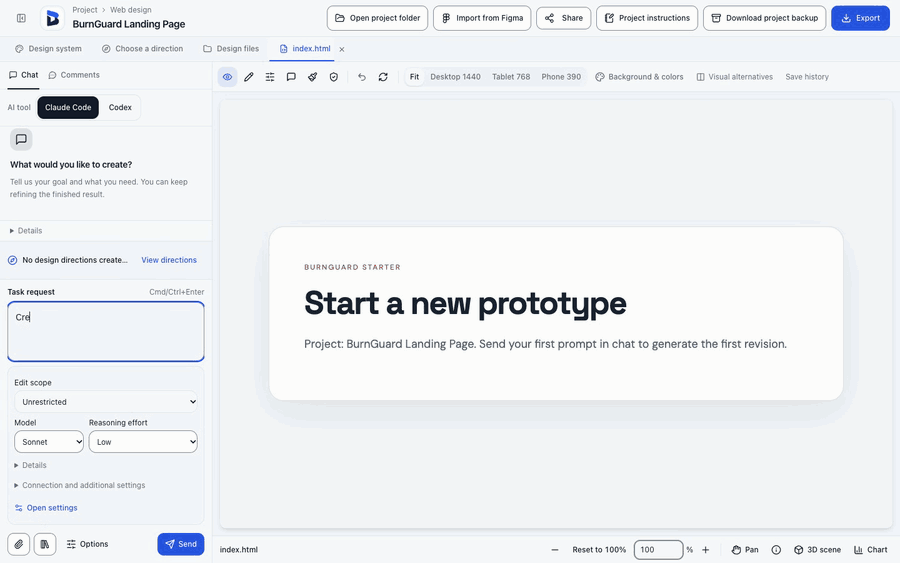
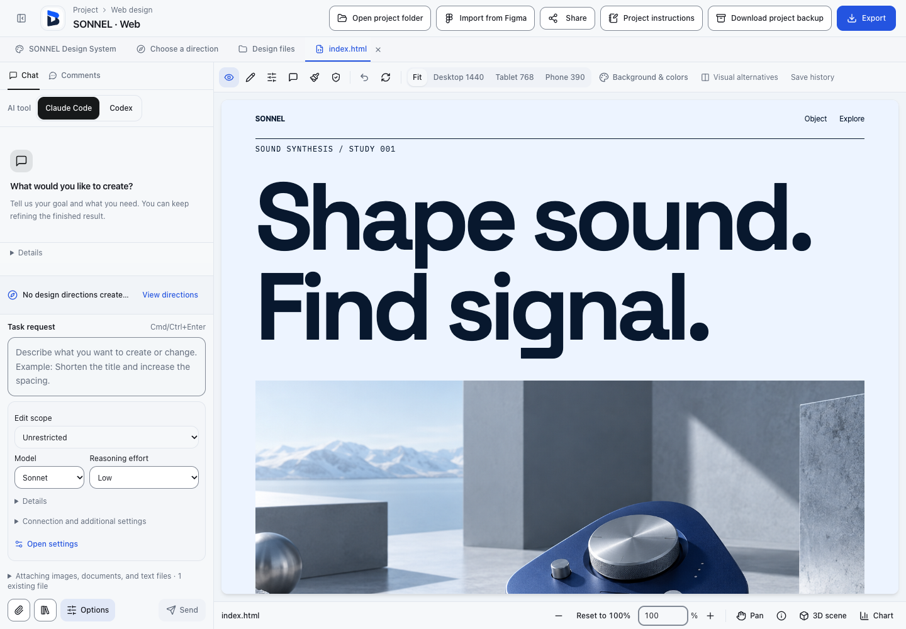
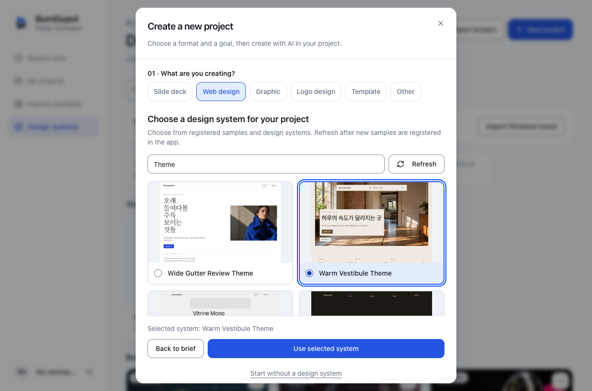
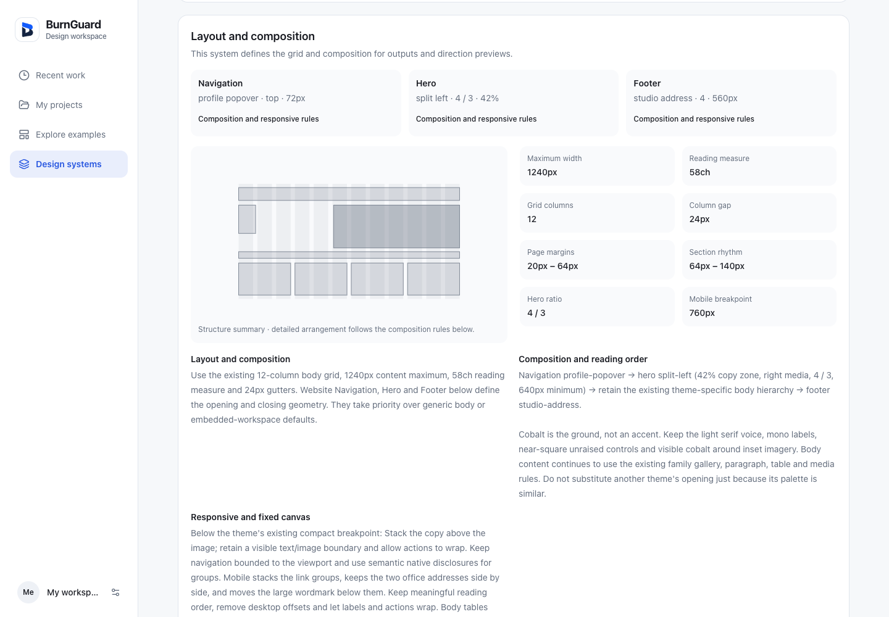
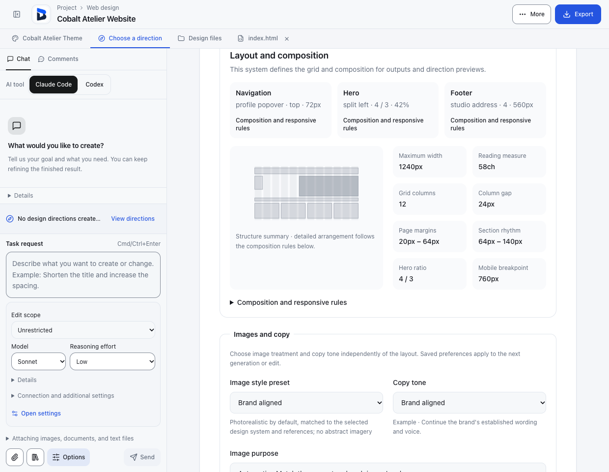
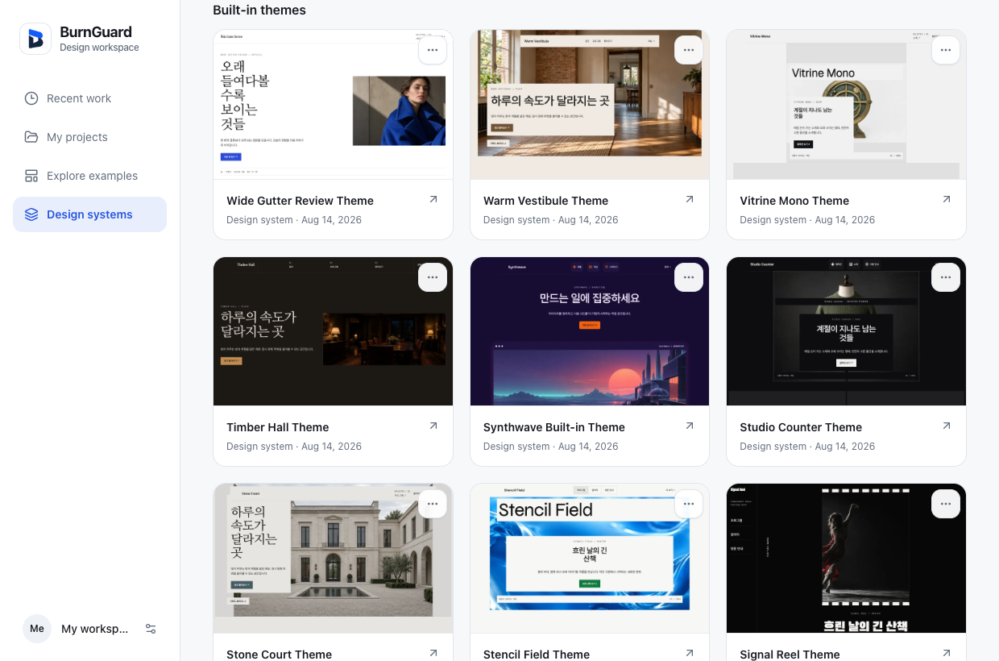
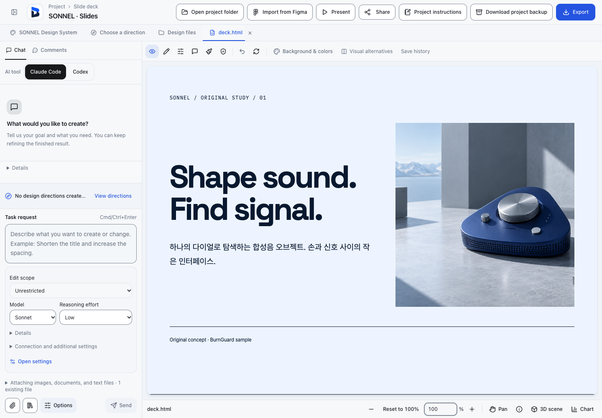

# BurnGuard

**Open-source local design workspace that connects to the Claude Code or Codex you already use.**



*Recorded for v0.5.31 with Claude Code (Sonnet, Low reasoning) and no design system. About 71 seconds of generation and automatic checks are sped up, setup and waiting gaps are cut, typing the prompt and editing the headline play at real speed, and one inaccurate sentence in the generated body copy was corrected on the canvas before the headline edit was recorded.*

[](https://github.com/ashmoonori-afk/BurnGuard/releases/latest) [](https://github.com/ashmoonori-afk/BurnGuard/releases) [](LICENSE) [](https://github.com/ashmoonori-afk/BurnGuard/stargazers)

⭐ If BurnGuard saves you time, a star on GitHub helps others find it.

Create websites, slide decks, graphics, and logos with AI, edit them on a live canvas, and keep every file on your computer. BurnGuard is a local desktop workspace for Windows and macOS. Connect your Claude Code or Codex CLI, pick a design system, and refine your work next to a live preview. Your projects and design systems stay on your machine, and AI requests run through your selected provider.

[Official website](https://burnguard-01m3hdkdxjzvrycasat63k706.vercel.app) · [Download the app](https://github.com/ashmoonori-afk/BurnGuard/releases/latest) · [Documentation](doc/README.md) · [한국어](README.ko.md) · [简体中文](README.zh-CN.md)

[User guide](doc/user-guide.md): build your first website, edit a single image, move a project to another computer, and locate your local files.



*The editor showing the bundled SONNEL website. Select a model on the left, inspect the rendered page on the right, and switch between preview, editing, and comments.*

## Start with a design direction

Pick a project format, write your idea, and optionally select a registered design system. BurnGuard suggests an editable project name from your idea, makes the audience field optional, shows up to four design-system suggestions inline, and keeps detailed brief controls under **Advanced**. Selecting **Create and generate** creates the project and sends your idea as the first request in one step. On a fresh install, a dismissible first-run card on Home checks your Claude Code and Codex connections and lets you create and generate your first website project directly from that card. Create a project without a design system if you prefer.

The built-in catalogue includes **43 themes**, including **33 original themes**. Each theme pairs typography and color tokens with navigation, hero, and footer layout rules. The original sample systems and prompt presets also include layout rules. You can import your own design systems from supported documents, websites, Git repositories, Figma files, or a single `DESIGN.md` Markdown file, then review and publish them for project use. Any registered system or built-in theme can also be downloaded as one `DESIGN.md` file, and each system stores up to 60 explicit **Do** and **Don't** rules that are included in every generation that uses it. [Explore the 43 built-in layouts](<design system themes/>)



*The Create a new project dialog with format chips, design-system search, and Refresh. You can select a registered system or built-in theme, or start without a design system.*

Open any system overview to read its navigation, hero, and footer rules. **Direction previews and full generations use the same layout rules**, including compact mode: the three direction previews vary message, evidence, and call-to-action emphasis within that system's structure. Direction previews are structural summaries, while rendered pages can include fuller detail. If you saved directions before selecting a system or before updating its rules, you can regenerate them from the current system.



*The Cobalt Atelier overview. Navigation, hero, and footer summaries remain visible; expand any section to read the full rules. Missing built-in rules are filled in automatically while your edited rules stay untouched.*



*A project's Choose a direction tab showing the same Cobalt Atelier layout rules, with Model set to Sonnet and Reasoning effort set to Low. This screenshot shows the configured guidance rather than a model benchmark.*

Desktop packages ship with **43 website examples**, **43 generated WebP illustrations**, and **43 website thumbnails captured in a headless browser**. The design-system library and project creation picker display those thumbnails, and each theme overview includes a scrollable website preview. Browse the [website preview gallery](design%20system%20themes/previews/index.html) and the [theme token catalogue](design%20system%20themes/catalogue.html).



*The design-system library displaying the bundled website thumbnails.*

These examples show each built-in theme's default layout. If a system already has its own preview files, BurnGuard shows those first; otherwise it shows the bundled reference without overwriting edited system files or publication state. Inside the app, all examples load fonts from the shared local font store.

**72 font families** are bundled with their license notices. Built-in fonts live in one shared local store, and fonts loaded on the canvas are reused across projects within the app window. New projects reference that store, and standalone exports bundle only the font files used by the document. [Font catalogue](assets/fonts/README.md) · [Design-system format](<design system sample/README.md>)

## One workspace, several kinds of output

| Make | Work with | Take away |
|---|---|---|
| Websites | Linked pages, shared stylesheets, images, and reusable sections | HTML, CSS, JS, and assets ZIP, or publish to your Vercel account |
| Slide decks | Slide previews, typography, presentation mode, and comments | HTML, PDF, or PPTX |
| Graphics | Custom artboard dimensions, posters, and multi-frame sets | PNG, PNG bundle, or PDF |
| Logos | Multi-round concept exploration with one chosen master | Master SVG¹, brand guidelines PDF, or HTML archive |
| Product detail pages | Long vertical pages with section images | Section-aligned PNG or JPEG slices |
| Platform pages | Cafe24 Smart Design or Imweb code-widget packages | Packages with step-by-step manual installation guides |

¹ Master SVG export is available for logo projects only.



*The same workspace editing a slide deck, with presentation and export controls in the top bar.*

PPTX exports place a high-resolution image on each slide and put the slide text in the speaker notes. Individual elements remain editable inside BurnGuard's HTML workspace; they are not exported as editable slide shapes.

## Refine the result where you see it

- **Edit on the canvas.** Select any element to change its text, link, image source, size, rotation, typography, spacing, or color. Website projects provide **Fit**, **Desktop 1440**, **Tablet 768**, and **Phone 390** viewport width buttons in the canvas top bar so you can verify responsive layouts before exporting. Save history, before and after revision thumbnails, and undo let you return to earlier versions.
- **Pin comments or save standing rules.** Click the canvas to pin feedback to an element and send an AI edit request. Pins stay attached while you scroll, and clicking a saved pin reopens its thread. Hover over the canvas and press **Alt+C** on Windows and Linux or **Option+C** on macOS for a quick comment. In chat, select **Keep as rule** on any follow-up message to turn a correction into a Do or Don't rule on the design system or add it to the project's instructions. Use **Project instructions** in the project top bar to edit standing notes (up to 4,000 characters) that are sent with every turn.
- **Attach reference files.** Attach supported PDF, PPTX, DOCX, image, or text files, or import an exported HTML project ZIP or `.burnguard-project` backup. Uploaded originals are stored separately from published website assets.
- **Check quality before exporting.** The Quality and UX panels check layout, contrast, links, and copy, and can send repair requests to the AI. Their findings are advisory, so review the rendered page before exporting or publishing.

The **Print check** dialog in the Export menu checks image resolution at print size, flagging warnings below 300 ppi and strong warnings below 150 ppi. It measures the remaining original pixels of `` elements after cropping, and measures inline and stylesheet CSS `background-image` URLs (including layered and print-only backgrounds) at their rendered `background-size` tile dimensions. It cannot detect whether a source image file was upscaled before being added to the project.

### Images, charts and 3D

Assign each image a clear role, such as product hero, campaign scene, explanatory illustration, or background. BurnGuard provides **21 image treatments** and **38 purpose recipes** across 13 domains. Generated images are **photorealistic by default**: abstract images are not generated unless requested, prompts are structured as photography briefs, and common generation defects (plastic skin, glowing backdrops, garbled text) are rejected during inspection. Non-photographic styles are used only when you select or request them. Your connected provider must support image generation for requests that create new images, and graphic or logo generation requires a signed-in Codex connection. [Image production guide](doc/image-production.md)

<p align="center">
  
</p>

*A rendered ODDWARD sample poster from local QA evidence. The poster's artwork is generated imagery; this image is an output preview rather than a full app window capture.*

Open the **Chart** panel to add area, line, bar, composed, radar, pie, radial, or Sankey charts. Paste tab-separated rows from a spreadsheet, adjust colors, and save portable SVG charts that keep their source data inside the HTML. The **3D** panel edits built-in 3D objects and sends scene modification requests to the AI. [Chart guide](doc/charts.md)

Explore the four original sample collections: **SONNEL**, **FOLIOVER**, **ODDWARD**, and **VELUNE**. Each collection includes a website, a six-slide deck, a graphic, and a design system. On the Examples view, select **See the brief** on any of the 12 sample cards to read its audience and objective in Korean, English, or Simplified Chinese, and select **Start from this** to open the creation dialog prefilled in your active interface language. [Sample collections](samples/original/README.md) · [Image recipe gallery](doc/images/image-recipes/README.md)

## Get started

1. **Install.** Download the Windows or macOS installer or portable ZIP from [GitHub Releases](https://github.com/ashmoonori-afk/BurnGuard/releases/latest). On Windows, run the installer, or extract the entire portable ZIP and open `BurnGuard.exe`. On macOS, run the installer, or move the portable app into Applications. Release packages are currently unsigned.
   - **On macOS:** Gatekeeper blocks the first launch. Try opening the app once, then open **System Settings > Privacy & Security > Open Anyway**. You can also run `xattr -dr com.apple.quarantine "/Applications/BurnGuard.app"` in Terminal. On macOS 15 and later, Control-clicking the app no longer bypasses Gatekeeper, so use System Settings.
   - **On Windows:** SmartScreen may show "Windows protected your PC" for the unsigned installer or portable executable. Select **More info**, then select **Run anyway**.
2. **Try an example.** Open a bundled sample project to test the canvas before connecting an AI tool, or click **See the brief** and **Start from this** on any example card.
3. **Connect your CLI.** Install and sign in to the Claude Code or Codex CLI, then select your tool and model in Settings. **Vanilla mode is on by default, and reasoning effort defaults to medium when the model supports it.** If medium is unavailable, BurnGuard picks the first supported effort, or low when effort metadata is unavailable. Vanilla mode ignores personal CLI plugins and global instructions while keeping BurnGuard's project context.
   - **Codex progress signal (enabled by default):** BurnGuard receives local Codex usage metrics on your computer so long silent steps, such as writing a large HTML page, are not mistaken for a stalled process. Disable **Detect that Codex is still working** in Settings if you do not want this check. If you already configured your own OpenTelemetry collector for Codex, this toggle stays off until you enable it manually, because Codex metrics are not sent to your collector while the local signal is active.
4. **Create a project.** Enter your idea, optionally pick a design system, and select **Create and generate** to create the project and start the first generation in one step.
5. **Export or publish.** Download standalone files from **Export**, click **Open project folder** in the project top bar to view the local files in your file manager, or select **Share → Prepare current output → Publish publicly** to deploy a website with your saved Vercel token.

| Requirement | Details |
|---|---|
| Windows desktop | Windows 10/11 x64, .NET Framework 4.8, and WebView2 Runtime |
| macOS desktop | macOS 14+ on Apple silicon |
| AI generation | Installed and signed-in `claude` or `codex` CLI with an active provider account |
| Rendering and export | Supported local Chromium-based browser; status is shown in Settings |
| Updates | Windows and macOS release feeds; keep your local profile folder when replacing a package |

Public web publishing uses your personal Vercel token and optional team ID. A token pasted in the Share dialog stays in memory for that publish only; a token saved in Settings is stored only in this computer's local configuration file. Hosting limits and visitor access follow your Vercel account settings. Cafe24 and Imweb export packages require manual upload and have not been tested in a live customer store.

## Your projects stay local

BurnGuard stores its SQLite database, projects, settings, design systems, and export cache in `~/.burnguard` (`%USERPROFILE%\.burnguard` on Windows). Keep this folder when upgrading the app. Select **Open project folder** in any open project to reveal its directory in Finder, File Explorer, or your system file manager.

Running a generation sends the selected project context to your chosen AI provider. Importing from a URL or publishing a site also uses the network. The local backend listens only on `127.0.0.1`, verifies launch authority on every request, and renders project pages inside a sandboxed iframe. [Security model](doc/01-architecture.md#7-security-and-safety-model)

## Run from source

Use **Bun 1.3.14**, matching the version pinned in CI.

```sh
git clone https://github.com/ashmoonori-afk/BurnGuard.git
cd BurnGuard
bun install --frozen-lockfile
bun run scripts/dev-launcher.ts
```

The launcher starts the frontend at `http://127.0.0.1:5173` and the backend at `http://127.0.0.1:14070`. Press Ctrl+C to stop both. On macOS, double-click `Start-BurnGuard.command` in Finder to start the same development stack (requires Bun); closing the Terminal window stops the servers. On Windows, `Start-BurnGuard.bat` builds and launches the desktop wrapper from source for development (requires Bun and the .NET 8 SDK); pass `--rebuild` after editing source files. Regular users should install a release package from GitHub Releases rather than running the source launchers.

To browse the repository's built-in theme pages directly, open `design system themes/previews/index.html` in a browser. The pages use the repository's local fonts and illustrations. After changing theme tokens, rebuild the token catalogue and website previews:

```sh
bun run catalogue
bun run previews
```

`previews` regenerates the HTML files and reuses the committed illustrations without calling an image generator. To recapture the website thumbnail images afterward, run `bun run previews:thumbnails` on a machine with Node.js and a local Chromium-based browser installed.

```sh
bun run typecheck
bun run check:whitespace
bun run build:frontend
node packages/backend/node_modules/playwright-core/cli.js install chromium
bun test
```

Run tests from the repository root so the test preload creates an isolated temporary profile directory. Browser tests require Node.js; install the Playwright browser build with the command above after `bun install`. When that build is not installed, the browser bridge falls back to installed system browser channels in the same order as its readiness probe. Browser QA requires Node.js and a local Chromium-based browser; on Windows runners, you may need to pass the full path to `bun.exe`. [Contributing and native builds](doc/CONTRIBUTING.md)

<details>
<summary>About the screenshots</summary>

All README screenshots and the demo GIF were captured on 2026-10-17 from the v0.5.31 release candidate, in Chrome on macOS, with a fresh isolated profile containing only the bundled samples and test input. They are not retouched or resized to a different aspect ratio.

</details>

### Read a project from your coding agent

Your coding agent can inspect a live BurnGuard project directly without exporting and re-importing files. From a source checkout, run:

```bash
bun scripts/burnguard-read.ts projects                 # list active projects: id, type, name, design system
bun scripts/burnguard-read.ts project <id>             # print a Markdown brief: directory, project instructions, design-system rules, files
bun scripts/burnguard-read.ts project <id> --json
```

The command opens the profile database at `BG_APP_ROOT` (default `~/.burnguard`) in read-only mode, writes nothing to disk, and opens no network port, so it is safe to run while BurnGuard is open.

## Changelog

### 0.5.31

- Creating a project starts with your idea, suggests an editable project name, makes the audience field optional, and sends the first request immediately when you select **Create and generate** (keeping your draft in the composer if sending fails). On a fresh install, Home shows a dismissible first-run card that checks your Claude Code and Codex connections, and all 15 bundled example cards let you read the brief in Korean, English, or Simplified Chinese and start a new project from it.
- Design systems store up to 60 **Do** and **Don't** rules (up to 280 characters each) that are included in every generation, and any registered system or built-in theme can be downloaded as a single `DESIGN.md` file or imported from a `.md` file. If a saved rule list is damaged, generation and the system view keep the valid rules and skip damaged entries, while rule edits refuse to overwrite the damaged list.
- Each project has a **Project instructions** dialog (up to 4,000 characters, included in `.burnguard-project` backups) that is sent with every request. Follow-up messages in chat offer **Keep as rule** to turn a correction into a Do or Don't rule on the design system or add it to the project instructions.
- Website projects include **Fit**, **Desktop 1440**, **Tablet 768**, and **Phone 390** preview width buttons in the canvas top bar. Save history and the current source comparison show retained before and after thumbnails beside the changed-file list, with clear fallback messages when a snapshot is unavailable.
- **Open project folder** in the project top bar opens the project's local folder in Finder, File Explorer, or your system file manager. From a source checkout, `bun scripts/burnguard-read.ts` reads the local profile database in read-only mode so your coding agent can list active projects or print a project's brief, instructions, design-system rules, and files while BurnGuard is open.
- **Print check** measures inline and stylesheet CSS `background-image` URLs at their rendered tile dimensions and notes that prior upscaling of source files is not detected, and BurnGuard falls back to an installed system browser when the bundled browser is absent. If BurnGuard quits unexpectedly during a generation, the next start stops the AI tool process that was still running before it restores project files (and stops startup with an error if it cannot confirm the process has stopped).
- Light and dark themes have clearer focus outlines, loading and empty states, tooltips, and improved text and control contrast, while the project header and canvas toolbar stay on a single row with **More** menus and open mode panels as a bottom sheet on narrow screens. The Export menu opens **Export settings**, **Print check**, and **Recent exports** in separate dialogs with an in-dialog step view for platform guides, and the documentation adds `doc/user-guide.md` and `Start-BurnGuard.command`.

### 0.5.30

- A generation refused by its design review can be opened as a separate unverified draft; the original project, revision and audit stay unchanged, and the draft stays unverified until an audit of its current content passes every check the failed review left incomplete. Expired, damaged or disallowed output is refused with a reason.
- Edits can be limited to text only or images only, optionally for chosen pages, artboards or elements. BurnGuard compares the result with the previous revision before publishing (text, image references, asset bytes including images shared with CSS backgrounds, styles, scripts, structure and whitespace that changes what is shown) and does not publish an out-of-scope change. History lists the changed pages, kinds of change and text before and after; it is a source comparison, not a pixel comparison.
- The export menu has a print check: page sizes, missing or remote fonts, browser readiness and each placed image's effective resolution after cropping (warning below 300 ppi, strong warning below 150 ppi; measured from the original pixels of `` elements only). Each export step has its own time limit, and a hung or failed step is named with a recovery action.
- The design review no longer reports a skip link revealed by keyboard focus as text overflow, and findings on elements without an element ID show a selector and position.
- Photographs of real-world subjects can carry a placement record (sourced references, scale, whether references reached the generator as reported by the agent, compared candidates, crop-only placement) and are shown as reference-verified only when it is complete. Stretched photographs and reference photos copied into published files are must-fix findings.
- Browser-based checks on Windows no longer fail partway through after a slow cold start.

### 0.5.29

- Checkpoint snapshots publish with integrity manifests and durable writes; an interrupted replacement recovers the previous verified pair, and an incomplete new snapshot is rejected rather than treated as legacy data.
- Artifact publication and rollback flush durable state before committing, and design-token and font CSS updates use atomic replacement. Deleted projects can be restored from Recently Deleted during their retention period.
- Database migrations back up existing databases, reject unknown newer schemas and check foreign-key integrity; CI rejects migration files that would reorder already published migrations.
- Export publishing rechecks the validated archive digest and size limit; a damaged checkpoint receipt no longer blocks a project bundle export.
- Provider stdout parsing is bounded, and cancellation tests cover owned children and detached descendants on Windows as well as POSIX. Codex image notifications no longer depend on a thread-ID filename hint, while the scanner still validates and selects the current thread's files.
- Project watchers coalesce bursts and drain cleanly on shutdown, and browser launch and cleanup settle transports and bound resource lifetimes.
- macOS finds provider CLIs from login-shell and Node-manager paths, and macOS update-cache pruning is serialized with download admission. Native shutdown and update dialogs are localized, closing during a running generation asks for confirmation, and comment drafts survive reopening.
- Quick Comment uses Alt/Option+C, Ctrl+Y works in both history handlers, and CLI probe failures get a distinct explanation and recovery guidance. Oversized imports show the supported limit where available and retain entered values.
- Local bootstrap requires launcher-held authority; an Origin header alone cannot obtain a capability. Token-bearing Figma requests refuse redirects, SVG direction previews receive protective raw-file headers, and archive extraction uses the containment resolver.
- Provider logs and completion messages avoid private staging paths. Ubuntu CI runs every discovered test file without baseline exclusions, including browser conformance and PDF/PNG/PPTX smoke checks; watcher and image regressions also run on macOS and Windows.

### 0.5.28

- A new website project built from an extracted design system now starts from class-based page skeletons, keeps the extracted hero image, and uses readable colours for buttons, subtitles and footer text. Pages you have already edited are never replaced by the starter.
- The quality review compares each section with the reference screenshots and crops the weakest sections, so a repair can fix one section at a time. A block-outline image is stored next to each reference screenshot.
- Website extraction is more accurate: subheadings, brand names, colour tokens and hero images are measured more reliably, fetched SVG images are cleaned, stylesheet redirects must stay on the same site, and the reason is recorded when layout measurement was not possible.
- Send is disabled with a reason and a Settings link when no AI tool is installed. A stopped or failed turn now always shows as stopped or failed, and a message sent while another one is running is refused cleanly instead of leaving a half-recorded turn.
- When BurnGuard restarts in the background, the open window says so and offers Reload. The workspace, canvas tools and Export stay usable at phone width.
- Reasoning effort defaults to medium where the model offers it, and the supported model lists use the current official model IDs.
- The canvas loads only the fonts a page uses and shows a rendering state until the page has painted. The Style side editor keeps the values you typed.
- Exports handle very large or unusual project files much faster and more safely, keep macOS file names with accented characters, and encode download file names correctly.
- Error messages no longer show private file paths or raw system error text, Settings errors explain how to recover, and Korean and Chinese copy is completed.
- The macOS app follows the same desktop rules as the Windows app, and update checks order pre-release versions correctly.

### 0.5.27

- Projects can be exported as portable `.burnguard-project` bundles and restored on another computer. Saved provider and access tokens and the local configuration are left out, and a restore always creates a new project.
- The handoff export adds a machine-readable manifest, `HANDOFF.md` and a prompt for coding CLIs, with copyable commands to continue in Claude Code or Codex.
- Settings > Runtime diagnostics lists each CLI connection with its version and capabilities and the stage where recent generations stopped; a failed or interrupted project can resume from the files already saved.
- Visual-quality guidance now covers websites, decks, graphics, logos and diagrams. The Quality panel adds advisory checks for separator dashes, placeholder copy, eyebrow labels, repeated or wrapped primary calls to action, accent and corner-radius counts and repeated adjacent sections, and rendered journey checks for websites: links that lead nowhere, mobile navigation that scrolls sideways, invisible keyboard focus and layout shift while loading.
- GIF attachments are accepted and images whose metadata embeds SVG text now decode. WebP files are validated before decoding, and colour sampling of untrusted images runs in a separate process.
- Generate two to four visual alternatives of a design, compare them side by side, promote one and delete the rest.
- PDF, PNG, PNG ZIP and PPTX exports show a per-page similarity score against the canvas. The check warns and never blocks the download.
- A Figma JSON export (with optional frame images) can be imported as an immutable reference matched to your design-system tokens. No Figma account token is needed.
- Website design systems are extracted page by page (navigation, footer and sitemap, respecting robots.txt), with measured layout, page colours, font roles, asset usage rules and asset prompts. With a local headless browser, up to four source pages are rendered offline and measured at desktop and mobile width, and reference screenshots of those pages are kept with the system.
- Website generation with an extracted system receives the measured values as hard constraints, a starter stylesheet and page skeletons, the reference screenshots as visual targets and one explicit precedence; the review checks the page against the measured layout and repairs it once.
- Generation guidance follows a capability profile per model family (claude-frontier, gpt-image, standard). With Claude Opus or Sonnet, BurnGuard designs a CSS and SVG logo from your tokens under seven construction rules when none is supplied, and finds openly licensed photos, illustrations and icons from open asset catalogues (no keys needed) instead of generating images, saving each file with its source and licence. Image-capable models on Codex keep generating their own images. Web search can be turned off in Settings, and the model picker recommends medium effort or higher.
- Generation and repair prompts carry evidence rules: visual claims only from rendered evidence, checks that did not run reported as unverified, and no unmeasured numbers.
- On first run the app follows your system language (Korean, Simplified Chinese, otherwise English); a language picked in Settings always wins. After your first successful export or publish the app asks once for a GitHub star; nothing is sent anywhere.

### 0.5.26

- Publishing a web project adds a small "Made with BurnGuard" badge to the published site only; downloaded ZIP exports are unchanged. The badge can be turned off in Settings or per publish.
- A Vercel token can be saved on this computer, so publishing becomes a single click. Settings only show whether a token is saved, never the token itself.
- The READMEs open with a recorded demo of a one-line prompt becoming a landing page.
- Hidden `<template>` and `<noscript>` markup in untrusted design-system sources is validated once per container and rejected when nested more than eight levels deep, so crafted markup can no longer stall the backend.
- The macOS release smoke test finds the canvas Edit control by its icon instead of by toolbar position, matching the toolbar that dropped the Select mode in 0.5.25.

### 0.5.25

- Generation turns commit even when the rendered design check cannot run (browser missing or a large site timing out); the chat shows a "review incomplete" badge instead of refusing the turn. Must-fix findings block a turn only in pages the turn changed, and a turn that edits shared CSS, scripts or images is checked across every page.
- The Quality panel reports checks that do not apply to decks and fixed-size graphics as not applicable, measures contrast on plain gradients, treats monospace text as its own font role, scans linked stylesheets for hard-coded colours, and flags remote fonts, images and frames that exports cannot fetch.
- The design brief carries the app language, and UX-review findings, quality and platform fix requests, direction previews and every app-built AI request are shown in Korean, English or Chinese; error messages exist for every server error code.
- The prompt harness reconciles contradictory rules (charts, palettes, breakpoints, social proof, map embeds, PowerShell on Windows only), adds Hangul typography rules, stages the bundled icon reference inside each project, gates the 3D and chart contracts by request, ships the complete design-system token block and trims pinned rules in compact mode.
- Canvas: the Edit panel edits image sources and link targets, resolved comments can be reopened, a new comment opens its editor, Ctrl/⌘+Z undoes style tweaks, colour swatches come from the page's own tokens, every bundled font is listed, and the duplicate Select mode is gone.
- Home and settings: dark mode applies on every screen, the language saves on click, backend detection failures show a retry, the creation draft clears after success, and search covers all projects.
- Website import strips scripts and forms instead of rejecting the page, records media-query context on extracted tokens and emits the canonical token contract; starter templates declare `--page-background`.

### 0.5.24

- New projects and seeded samples load in the canvas, live preview and Present again; the bundled font set had outgrown the canvas font limit.
- PDF and PNG ZIP exports keep authored grid/flex layouts and page backgrounds, wait for lazy-loaded images, and export seeded sample graphics as artboard PDFs. Decks too large for PDF are refused before rendering with a clear reason.
- Cafe24 and Imweb packages accept ordinary links, include every page and the assets only subpages use, keep footer scripts working, ship font licenses, and no longer need a headless browser.
- Exports include only the bundled fonts the document uses, ZIP files carry local timestamps, and deleted projects no longer leave cached exports behind.
- Chat reports whether a turn's work actually reached the project, including failed deck reviews and repairs; attached source pages map one-to-one to slides when requested.
- macOS app: finds CLIs and Python installed with Homebrew, in `~/.local/bin`, or through npm under nvm, Volta, fnm or a custom npm prefix (it reads your login-shell PATH), opens external links in the browser, supports standard ⌘C/⌘V/⌘Q shortcuts, replaces an existing download, and waits for the local server to stop before quitting.
- Windows app: stays open on recoverable WebView2 process failures and lists installed fonts. Linux source runs list installed fonts, and one backend now owns each profile on macOS and Linux.
- Settings are split into a shared profile and device-local credentials and policy.

### 0.5.23

- Logo projects show Codex image outputs as they arrive, keep candidate bytes verbatim, audit text per artboard and report clearer failure stages.
- Windows owns the backend's process trees with job objects, quotes batch provider arguments safely and routes native downloads by filename.
- Release packaging verifies native canvas, persistence and exports on Windows and macOS before a draft is prepared.

### 0.5.22

- Add logo-design projects with exploration rounds, a selected SVG master and brand-guideline deliverables.
- macOS: working sandboxed canvases, native export downloads, installed font listing and an app-owned Python environment for PDF dependencies.
- Security fixes: PNG decoded-size checks before decompression, SVG revalidation before design-system promotion and stricter POSIX package permissions.
- 0.5.20 and 0.5.21 were not publicly released.

### 0.5.19

- Recover verified legacy attachment-only artifact revisions during startup without replacing project files or uploaded originals.
- Normalize Windows line endings when reading design-system surface rules.
- Fix Windows browser-test startup and isolate provider/render fixtures; include legacy recovery checks in Windows release packaging.

### 0.5.18

- Fit oversized slide content to the artboard as content and images load.
- Validate actual slide content, slide counts, runtime and local images before marking generation complete; continue unfinished output instead of accepting placeholders.
- Default generated imagery to photorealistic subjects and avoid abstract decorative images.
- Keep historical specifications 04 through 23 and reference notes local; simplify the public documentation index.

### 0.5.17

- Show slide or website thumbnails for the selected project format.
- Preserve generated HTML and assets when generation is stopped, and restore the previous entrypoint if it was removed mid-write.
- Pin project design rules, audit rendered output and include review evidence in handoff exports.

[All releases](https://github.com/ashmoonori-afk/BurnGuard/releases)

## Documentation and license

[Official website](https://burnguard-01m3hdkdxjzvrycasat63k706.vercel.app) · [User guide](doc/user-guide.md) · [Documentation index](doc/README.md) · [Architecture](doc/01-architecture.md) · [Design guidance](doc/design-craft.md) · [Installation and updates](https://github.com/ashmoonori-afk/BurnGuard/releases/latest)

BurnGuard is licensed under **Apache-2.0**. See [LICENSE](LICENSE), [NOTICE](NOTICE), and the [image provenance notes](doc/images/README.md).
